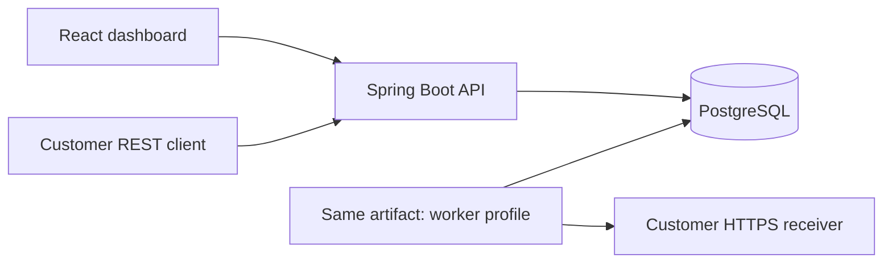
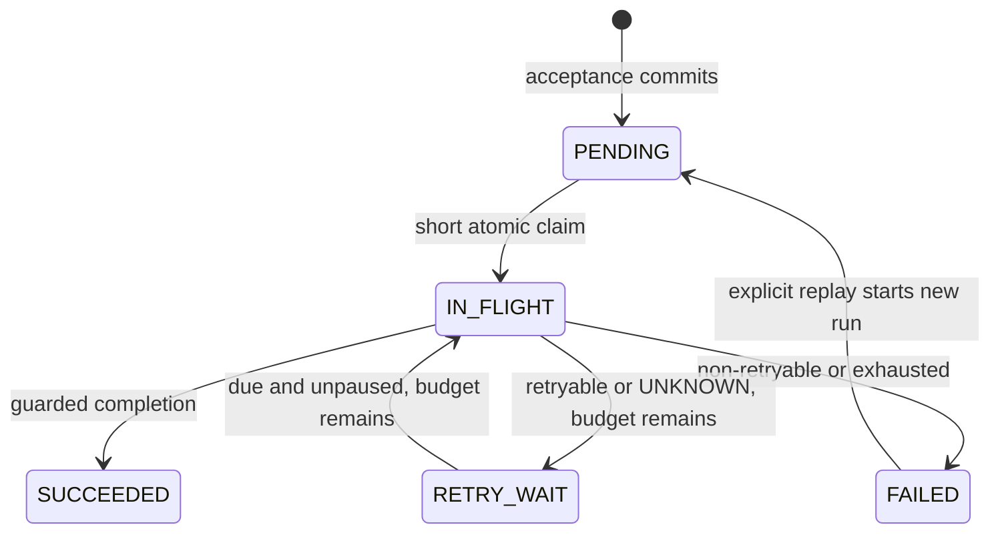

# Architecture — Phase 7d2

## Shape and modules

Relay starts as a modular monolith: one Java codebase and one backend artifact, launched as an API process and as a separate worker process sharing PostgreSQL. React talks to the API over HTTP. PostgreSQL stores business data and durable delivery work. SQL through Spring JDBC makes transaction and locking behavior explicit. Flyway owns schema changes. No queue broker, cache, workflow framework or additional backend service is needed.

The React dashboard calls owner-scoped session APIs for workspace access, endpoint/key management, filtered event lists, history and replay. Browser writes use CSRF protection. Account/session routes are in `AUTHENTICATION.md`; ingestion in `INGESTION.md`; worker execution/history in `WORKER.md`; UI behavior and browser tests in `DASHBOARD.md`. REST ingestion commits event/delivery rows. The worker independently polls, claims available capacity, sends bounded HTTP outside transactions and completes or recovers leases.

| Module | Responsibility | First behavior |
| --- | --- | --- |
| `system` | Foundation status route | Phase 0 |
| `identity` / `security` | Registration, session credentials and authentication chains | Phase 1 |
| `apikeys` | Workspace credential generation, bearer authentication and revocation | Phase 1 |
| `workspaces` | Ownership and tenant authorization | Phase 1 |
| `endpoints` | Destination validation, listing and pause state | Phase 2 |
| `events` | Atomic ingestion, idempotency and status queries | Phase 2 |
| `delivery` | Claims, leases, fencing, history, bounded retries and replay | Phases 3–4 |
| `worker` | Worker runtime and bounded execution | Phase 3b |
| `observability` | Safe log correlation, independent operator access and cached durable metrics | Phase 7b |

Dependencies flow from HTTP/runtime entry points through application services to database access. The delivery module includes coordination, history, fenced payload loading and protected HTTP transport. Work that must commit atomically uses one local database transaction; network work runs outside transactions.

## Schema (implemented)

V1–V6 are unchanged. V7 adds encrypted endpoint signing keys, bounded response previews and persisted workspace concurrency limits. No customer data is seeded.

| Table | Columns and constraints |
| --- | --- |
| `accounts` | UUID `id`; unique, trimmed lowercase `email`; nonempty `password_hash`; UTC-capable `created_at` (`timestamptz`) |
| `workspaces` | UUID `id`; mandatory `owner_account_id` FK to accounts; nonblank name; creation time; delivery concurrency limit 1–32 |
| `api_keys` | UUID `id`; workspace FK; nonblank name; unique public prefix derived from id; 32-byte SHA256 digest; creation/revocation timestamps; index for workspace listing |
| `endpoints` | UUID `id`; workspace FK; HTTPS URL; pause flag/timestamps; unique `(workspace_id,id)`; workspace listing index |
| `endpoint_signing_keys` | Composite workspace/endpoint PK/FK; 60-byte AES-GCM encrypted envelope; delete cascades with endpoint |
| `events` | Stable UUID; composite workspace/endpoint FK; exact payload bytes (1–262144); 32-byte request digest; optional idempotency key unique within workspace; acceptance timestamp and listing indexes |
| `deliveries` | UUID; composite workspace/event FK; unique event id; PENDING/RETRY_WAIT/IN_FLIGHT/SUCCEEDED/FAILED; lifetime claim generation/token/lease; replay generation, used/max attempts and nullable due time; pending/due/expired indexes |
| `delivery_attempts` | UUID; composite workspace/delivery FK; unique lifetime generation/token and unique replay-generation/run-attempt ordinal; start/finish/outcome; HTTP metadata plus bounded preview/truncation flag |

UUIDs are generated by the application. No extensions are required. Emails are trimmed, lowercased and validated; lowercasing is a deliberate login-identifier convention. Passwords use Spring Security BCrypt cost 12 with an algorithm prefix, and ownership is enforced in SQL for every browser workspace/key operation. The FK alone does not enforce request-level isolation. There is no invitation or membership system. API-key authentication derives the workspace from the credential rather than accepting a caller-selected workspace id.

Browser authentication uses Spring Security's form-login/session/logout machinery with CSRF protection. Sessions stay in memory for one API instance; restart requires signing in again. A separate stateless chain handles bearer keys under `/api/v1/**` and never uses browser cookies. API keys cannot manage accounts, workspaces or other keys. See `AUTHENTICATION.md` for contracts, credential storage and limitations.

Future schema changes should follow the relevant phase rather than prebuilding unrelated features. Phase 6 reuses the existing schema and scoped APIs, adding optional event-list filters before pagination.

The first product version targets one endpoint per event and one delivery row per event. Composite tenant-aware references prevent linking an event to another workspace's endpoint. Every customer query and mutation must also scope authorization to the authenticated workspace. API keys are high-entropy credentials generated through established cryptographic libraries, hashed at rest and absent from logs.

Payload identity is the exact accepted UTF-8 JSON bytes plus the endpoint UUID. Reusing a workspace-scoped key with identical input returns the same acceptance fields; differing bytes or endpoint return 409. The stored digest is SHA256 of the ASCII domain `relay.ingestion.v1` followed by a zero byte, 16 endpoint UUID bytes (most-significant long then least-significant long, big endian), then the raw payload. Matching also compares endpoint and exact payload bytes. An omitted key permits a new event each time.

## Delivery states and guarantees

The worker sends HTTP after claim commit. A 2xx response succeeds; retryable failures and UNKNOWN expiry schedule bounded backoff while budget remains. Otherwise the delivery becomes FAILED. Every claim consumes its run's budget. Explicit generation-guarded replay starts a fresh bounded run with the same event/delivery and retained lifetime history. Pausing blocks acceptance, claims and replay while permitting completion/recovery/history and identical ingestion retries. See RETRIES.md for classification and timing.

Delivery attempts can be duplicated. A receiver may process a request before a worker crashes or loses its lease. Recovery can send it again. An expired attempt may have an **unknown outcome**; do not relabel it as a confirmed receiver failure. There is no exactly-once or guaranteed eventual-delivery claim. Stable event IDs allow receiver-side deduplication.

## Transaction boundaries

1. **Accept (implemented):** authenticate the key; read at most 256 KiB plus one byte and validate before opening a transaction. At `READ_COMMITTED`, check for an existing key, then lock the scoped endpoint `FOR SHARE` so pausing and new acceptance serialize. Recheck idempotency after waiting for that lock. A new request must target an unpaused endpoint. Insert the event with `ON CONFLICT DO NOTHING`, then its delivery in the same transaction. A competing duplicate waits for the winner and reads its committed result in a separate statement, whose fresh snapshot can see both rows. Return 202 only after commit. No lock covers HTTP or DNS work. Lost responses are handled by identical idempotent resubmission.
2. **Claim (implemented):** reserve available process slots, lock pending/unpaused deliveries and endpoints with SKIP LOCKED, then serialize workspace count/increment under a short NO KEY UPDATE workspace lock. Admit only remaining workspace capacity. Tokens/generations, leases and attempts commit together. No workspace lock spans HTTP.
3. **Send (implemented):** a separate short transaction loads a fenced payload snapshot/remaining lease and provisions/decrypts its scoped signing key. Release the connection, validate/pin addresses, sign exact bytes and send outside a transaction before lease safety expires. Capture only a bounded response prefix within the request deadline. No request/DNS code exists in the claim service.
4. **Complete (implemented):** lock current claim identity, then check the live database clock against its lease. Finish its exact attempt and atomically succeed, terminate or schedule RETRY_WAIT. A lock wait cannot preserve expired authority. Invalid/stale results return false. Fencing protects database state, not an already-sent request.
5. **Recover (implemented):** lock expired claims with SKIP LOCKED, close exact attempts UNKNOWN and schedule or exhaust the delivery's budget atomically. Recovery also works for paused endpoints, which remain ineligible for a claim.
6. **Replay (implemented):** lock the scoped delivery, require FAILED plus expected replay generation, then lock/check its endpoint is unpaused. Increment replay generation and reset only the run budget/counter and due state. Lifetime history/generation and accepted input remain intact; retry/claim/replay serialize on the delivery row.

## Security and operating boundaries

Outbound HTTP requires HTTPS, rejects internal/private/special IPv4/IPv6 addresses and pins validated DNS results to the connection. Redirects, proxies and implicit retries are disabled. A default-off development exception permits one exact literal-loopback receiver URL without disabling TLS checks. HMAC covers exact payload bytes and identifiers/timestamp; per-endpoint secrets are encrypted under a separately supplied master. Workspace claims and response capture are bounded. See DELIVERY_SECURITY.md for verification, setup, resource semantics and the standalone receiver.

Never log raw credentials, API/signing/master keys, signatures, unrestricted payloads or response previews. Result/secret diagnostic text is redacted. Validation responses do not echo rejected values; parser/persistence errors do not log failing-row payloads. Previews remain scoped untrusted text in history. Phase 7a closes worker admission and drains already admitted delivery tasks before dependency destruction, with one bounded grace/cancellation wait. Late unused claims and unfinished attempts retain normal lease recovery; forced cancellation does not invent receiver-failure results. See [shutdown semantics and limits](WORKER_SHUTDOWN.md).

Phase 7b adds ECS JSON application logs with server-generated request IDs and durable event/delivery/attempt identifiers. Only fixed safe fields are added by application code. Acceptance/replay logs follow committed service returns; worker completion logs distinguish committed, rejected and abandoned results. Minimal liveness and database-aware readiness probes share the customer API listener. The worker remains a non-web process.

An independent, default-disabled operator bearer credential permits only GET Prometheus scraping; customer sessions and workspace keys grant no management access. An API-only single-task collector periodically aggregates retained PostgreSQL rows into an immutable memory cache. Scrapes issue no delivery SQL. Delivery/attempt counts, ready depth, original-event age, initial claim delay, transport timing and retry/replay claim totals use finite labels and explicit gauge semantics. Failed refreshes retain old data and expose failure/freshness; credentials, destinations and customer identifiers are excluded from custom metric tags. See [access, metric definitions and limits](OBSERVABILITY.md).

Phase 7c adds two independent GitHub Actions jobs: full backend verification using Testcontainers, and dashboard compilation/browser journeys using a separate disposable PostgreSQL service. Actions/toolchains are pinned; credentials and state are test-only, checkout access is read-only, and raw test reports/captures are not uploaded. Both jobs passed on hosted Ubuntu/Docker; the local Windows environment still has no Docker/Compose installation. See [CI evidence and validation boundaries](CI.md).

Phase 7d1 adds a bounded Node harness around the packaged API, separate worker, dedicated PostgreSQL database and independent verifying receiver. It bootstraps real API credentials, compares accepted IDs to committed ledger rows and signed receipts, records monotonic client/drain timings separately from stored SQL timestamps, and removes owned fixtures. Three 1,000-event batches on the stated shared host completed successfully; observed drain varied from 28.2 to 63.8 events/s. See [workload, measurement definitions, hardware and results](LOAD_TESTING.md). Healthy observations do not establish sustainable capacity or fault behavior.

Phase 7d2 adds two controlled failure demonstrations around the same application artifact. A verified503 triggers automatic retry and a verified204; forced worker termination after a simulated receiver effect leaves an unfinished attempt, then natural PostgreSQL-clock lease expiry records UNKNOWN before the replacement succeeds. Receiver memory deduplication illustrates prevention of a repeated effect for the stable event ID; it resets on receiver restart. The runner changes no delivery timestamps or history to accelerate recovery. See [orchestration, retained histories and limits](FAILURE_DEMONSTRATIONS.md).

Later Phase 7 work finishes deployment guidance and final startup/project verification. The status route remains a local connectivity check and its phase 7 value does not imply all Phase 7 work is complete.

