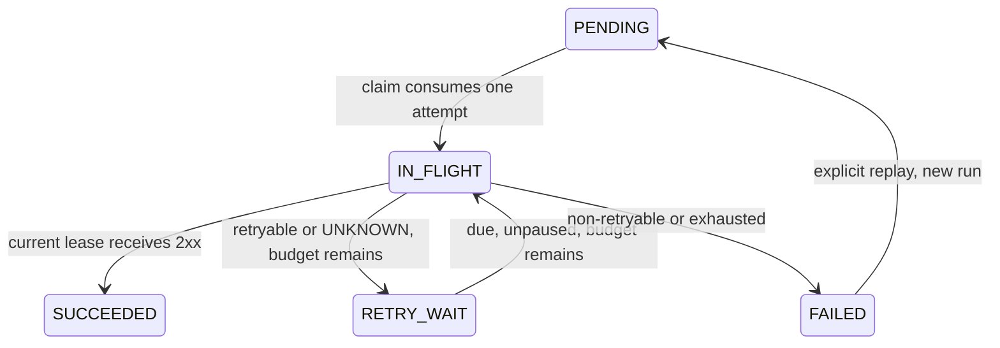

# Retry policy and manual replay — Phase 4

An accepted event keeps the same event ID, delivery ID, destination and payload throughout automatic retries and manual replay. Each claim receives a new attempt ID and increasing lifetime `generation`. A `replayGeneration` identifies a delivery run, starting at zero. `runAttempt` starts at one within each run. History is never reset by replay.

## Policy and limits

| Result | Behavior while budget remains |
| --- | --- |
| HTTP 2xx | SUCCEEDED |
| HTTP 408, 429, 500, 502, 503, 504 | Schedule retry |
| REQUEST_TIMEOUT, CONNECT_TIMEOUT, DNS_ERROR, NETWORK_ERROR, RESOURCE_LIMIT | Schedule retry |
| Other HTTP statuses, including redirects; DESTINATION_BLOCKED; INTERNAL_ERROR | Terminal FAILED |
| Expired claim with no accepted result | Finish attempt UNKNOWN; schedule retry |

All claims consume budget, including a crash before HTTP, an ambiguous timeout and an expired claim. With no budget remaining, a failed or UNKNOWN attempt leaves the delivery terminal FAILED. UNKNOWN remains UNKNOWN in history: exhaustion does not turn it into a confirmed receiver failure. NETWORK_ERROR includes I/O/TLS failures; these are retried only within the same bounded budget, without weakening certificate checks. The transport itself never retries or follows redirects.

| Spring property | Default | Bounds |
| --- | --- | --- |
| `relay.retry.max-attempts` | 5 total attempts, including the first | 1–20 |
| `relay.retry.base-delay` | 1s | 1ms–1h |
| `relay.retry.max-delay` | 5m | At least base delay, at most 24h |

The API snapshots `max-attempts` into each new delivery and each manually replayed run. Workers read that stored budget; changing process configuration does not reset existing runs. The next due timestamp is durable. Subsequent backoff calculations use the worker's current base/cap settings. Keep process configuration consistent.

After used attempt `n`, the exponential ceiling in milliseconds is `min(maxDelay, baseDelay × 2^(n−1))`. Equal jitter chooses an integer delay from `ceil(ceiling/2)` through `ceiling`, inclusive. Thus the first default retry waits 500–1000ms; the next 1000–2000ms. Arithmetic is capped before multiplication, delays remain positive and timestamp overflow is guarded. Fractional milliseconds are truncated for scheduling. The platform uses its own bounded policy; it does not parse receiver `Retry-After` headers in this version.

Scheduling and due eligibility use an injected UTC `Clock`; tests substitute a controllable clock and deterministic jitter. Production machines should synchronize their clocks. Leases and stale-completion authorization still use PostgreSQL's clock, independently of scheduling time. A clock skew can affect when a retry runs, but cannot remove the persisted budget or bypass lease fencing.

## States and transactions



Failed HTTP attempts remain FAILED in history even while the delivery is RETRY_WAIT. Scheduling and finishing the exact attempt commit atomically under the current delivery lock/token/generation/live-lease guard. A failed database write rolls both back. Recovery atomically closes the expired attempt UNKNOWN and schedules or terminates the delivery. No retry sleeps while holding a transaction or worker slot: future work stays in PostgreSQL until a poll finds it due.

Pausing prevents new acceptance and claims, including due retries. Already committed claims can finish; retry schedules can be recorded while paused but are not claimed until unpaused. Pausing does not change their due times or replenish their budget. Replay while paused returns 409.

V6 preserves pre-policy attempts as run zero with their lifetime generation as run ordinal. Already-used claims consume that initial budget. Legacy runs with more than five historical claims retain a budget equal to that count and cannot gain further automatic claims; exhausted pending work becomes FAILED. Future runs snapshot the validated configured budget.

## Replay API

| Route | Authentication |
| --- | --- |
| `POST /api/v1/events/{eventId}/replay` | Workspace bearer key |
| `POST /api/workspaces/{workspaceId}/events/{eventId}/replay` | Owner session and CSRF token |

Send `Content-Type: application/json` and an integer JSON body `{ "expectedReplayGeneration": 0 }`, using the current event status's `replayGeneration`. Missing, null, negative, fractional, string or out-of-range generations return 400. A successful 202 means the new run's PENDING work committed; it does not mean receiver success. The body is `{eventId,deliveryId,replayGeneration,status}`, with incremented generation and status PENDING.

Replay only accepts a terminal FAILED delivery, a matching generation and an unpaused endpoint. Other states, paused endpoints and stale generations return 409; missing/foreign events return 404. Session-only requests cannot use bearer routes, and bearer credentials cannot access owner routes.

Replay locks the delivery before checking/locking its endpoint. It increments replay generation, clears scheduling, resets only the per-run counter/budget, and preserves all attempts, acceptance fields, payload bytes and lifetime claim generation. Concurrent requests with the same expected generation accept at most one new run. Even if that new run fails quickly, a delayed duplicate carrying the previous generation cannot replay it again. A lost 202 response may therefore produce 409 on resubmission; inspect current status/history. Automatic retry/claim/recovery and replay serialize on the same delivery row; RETRY_WAIT cannot be manually replayed. Stale results from older claims cannot alter a replayed run.

Using variables from the ingestion walkthrough:

```powershell
$event = Invoke-RestMethod "$base/api/v1/events/$($accepted.eventId)" -Headers $bearer
$replayBody = @{ expectedReplayGeneration = $event.replayGeneration } | ConvertTo-Json
Invoke-RestMethod "$base/api/v1/events/$($accepted.eventId)/replay" -Method Post -Headers $bearer -ContentType 'application/json' -Body $replayBody
```

Event status/list items include `attemptsInRun`, `maxAttempts`, `replayGeneration`, and `nextAttemptAt` (non-null only in RETRY_WAIT). Attempts include run fields and, from Phase 5, bounded `responsePreview`/`responseTruncated`. Lifetime ordering remains intact; accepted payloads, claim tokens and credentials stay private.

## Validation and guarantees

Run the complete `mvnw verify` suite. PostgreSQL/receiver tests cover failure then recovery, exact due boundaries through an injected clock, exhaustion, UNKNOWN budget consumption, non-retryable responses, paused retry/replay, atomic rollback, history, stale completion and concurrent replay/automatic claim behavior. A migration test upgrades nonempty V5 history. Existing actual worker kill/recovery and isolation regressions remain in the suite. PROGRESS.md records the executed results and remaining environment gaps.

Retries and explicit replay can cause duplicates. A receiver should deduplicate stable event IDs; [DELIVERY_SECURITY.md](DELIVERY_SECURITY.md) includes the signed sample receiver and its in-memory deduplication limits. The platform does not promise exactly-once delivery or guaranteed eventual delivery.

Status semantics references: [HTTP Semantics](https://www.rfc-editor.org/rfc/rfc9110.html), [429 Too Many Requests](https://www.rfc-editor.org/rfc/rfc6585.html#section-4). The retry selection and budget above are this platform's policy.
